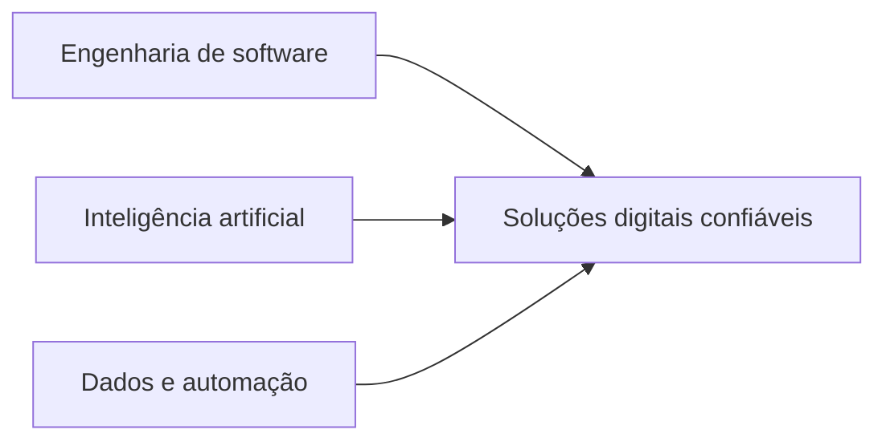

<h1 align="center">👨🏽‍💻 Robson Marcolino</h1>
<h3 align="center">Engenheiro de Software na Ambev Tech | Engenharia & Inteligência Artificial</h3>

<a href="#sobre-mim">Sobre mim</a> &nbsp;·&nbsp;
<a href="#como-atuo">Como atuo</a> &nbsp;·&nbsp;
<a href="#stack">Stack</a>

## Sobre mim

<table>
<tr>
<td width="66%" valign="middle">

Sou Robson Marcolino, Engenheiro de Software na Ambev Tech, na área de Engenharia e Inteligência Artificial. Desenvolvo soluções digitais conectando engenharia de software, dados, automação e IA aplicada a desafios reais.

Meu foco está em sistemas inteligentes, arquitetura de software e produtos que aliam escala, confiabilidade e uma boa experiência de uso.

</td>
<td width="34%" align="center" valign="middle">
<strong>ÁREAS DE ATUAÇÃO</strong>  
<kbd>ENGENHARIA</kbd>  
<kbd>IA GENERATIVA</kbd>  
<kbd>AUTOMAÇÃO</kbd>
</td>
</tr>
</table>

## Como atuo

## Stack

Explorar tecnologias de desenvolvimento, dados e ferramentas

#### Desenvolvimento

#### Dados e ferramentas

